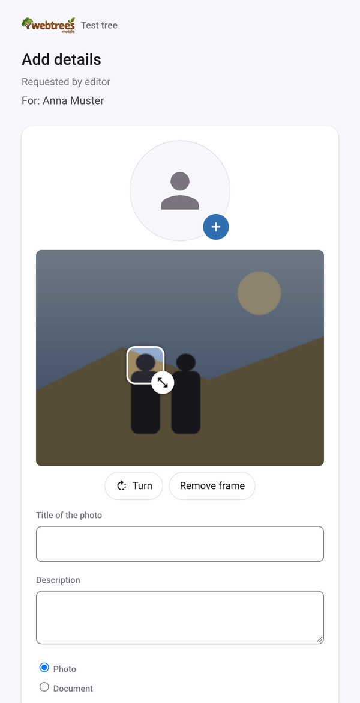
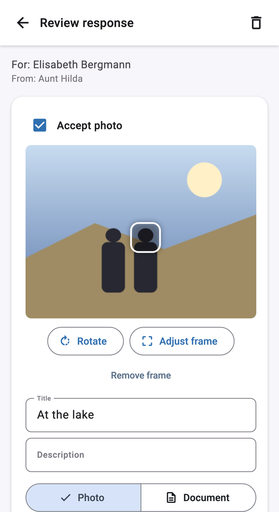
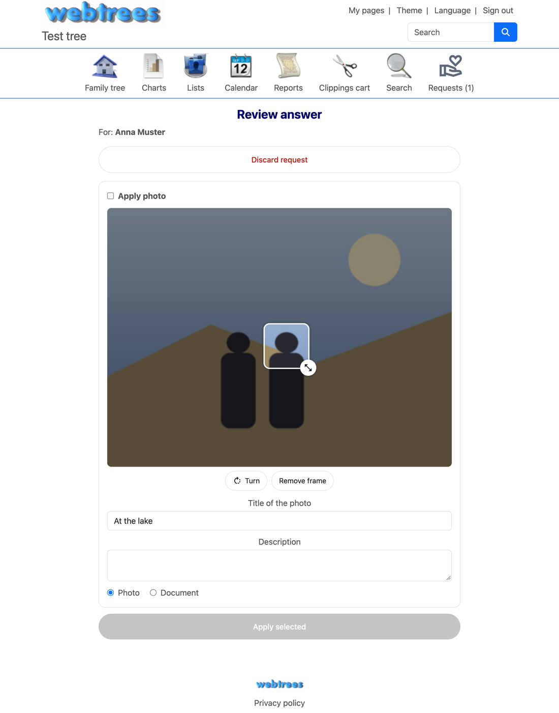

# webtrees-contribution-request

**English** · [Deutsch](README.de.md)

A module for [webtrees](https://webtrees.net/) that lets you share a single person with someone who has
**no** webtrees account — for example a relative who certainly knows a birth date, but would never create an
account themselves. An ordinary add-on module: it lives in `modules_v4/`, the webtrees core is untouched.

**Even easier with the app:** [webtrees mobile](https://github.com/Schoaf/webtrees-mobile), the free app for
iPhone, iPad and Android, has this module built in. Tap “Ask for help” on a person, send the link by message or
email, and review the answer right on your phone – turn and frame the photo, pick the details to keep, done.
No computer needed, wherever you are.

| The relative's page – no account needed | Reviewing in the app | Reviewing in webtrees |
| :-: | :-: | :-: |
|  |  |  |

| | |
| - | - |
| webtrees | 2.2.x |
| PHP | 8.3 or newer |
| License | GPL-3.0 |

## How it works

1. **Request:** a signed-in editor picks a person and creates a link. This immediately snapshots that
   person's key facts (birth/death date and place).
2. **The link** opens a small, phone-friendly webtrees page — no login required. The person sees exactly
   what was known at request time (not the tree's current, possibly more sensitive state), can correct or
   complete the fields, add a photo - turned the right way round, framed around the person and described -
   and add a free-text note.
3. **The answer** goes back to whoever made the request — as a notification (an icon in webtrees, optionally
   in a companion app) and by email. webtrees has no private-messaging feature, so this module stores the
   request and its response itself, in a single table.
4. **Applying it:** the requester sees old vs. proposed values side by side, picks what to keep, and saves.
   This runs as an ordinary edit under their own account — exactly as if they'd received the information by
   phone and typed it in themselves. Existing rules (moderation, "auto-accept edits", …) apply unchanged.
   A photo can still be turned and framed first; it becomes a media object with its title, description and
   type, linked with its frame as GEDCOM 7 `2 CROP`, and the person's photo if they had none (or if chosen).
5. **Asking further:** after submitting, the guest is offered the person's parents/children to help with
   next, ranked by how much is still missing for them — no new link needs to be created for that.

A link is valid for **2 days**.

## Installation

1. Download `webtrees-contribution-request-<version>.zip` from the
   [latest release](https://github.com/Schoaf/webtrees-contribution-request/releases/latest).
2. Unpack it into `modules_v4/`, so that `modules_v4/webtrees-contribution-request/module.php` exists.
3. Done. The module creates its one table (`webtreesshare_request`) on first use and is then active, visible
   under *Control panel → Modules → All modules*. webtrees shows a notice there when a newer version is out.

Updating: replace the folder. Removing: delete the folder (the table stays behind and can be dropped
manually if desired).

## Privacy and permissions

- Only someone who could already edit a person can create a request for them.
- Whoever opens the link only ever sees the frozen snapshot, never the tree's current, potentially more
  sensitive state.
- The response is **never** applied automatically — only once the requester confirms it field by field does
  it become a real edit, following the exact same rules as any other edit.

## For developers

Start reading at the top of `WebtreesShareModule.php`. Main endpoints
(`index.php?route=/module/_webtrees-contribution-request_/<Action>[/<tree>]`, the same no-custom-routes convention every webtrees module
uses):

| Action | Method | Auth? | Purpose |
| - | - | - | - |
| `Info` | GET | no | `{active, version}` — e.g. for an app to check the module is enabled |
| `CreateRequest` | POST | yes, editor | create a request, returns `{url, expires}` |
| `RequestEmailTemplate` | GET | yes | preview of the email text, for personalizing |
| `SendRequestEmail` | POST | yes | sends the email server-side |
| `Request` | GET/POST | no | the form page shown to the requested person |
| `RequestContinue` | POST | no | creates a follow-up request from the "ask further" list |
| `RequestReview` | GET/POST | yes, requester | list, or the compare-and-apply page |
| `RequestPhoto` | GET | yes, requester | streams a not-yet-reviewed photo for the review page |
| `RequestNotifications` | GET | yes | `{unread}` for a notification badge |

A submitted photo is held in webtrees' own "data" folder, never the tree's media library, until the
requester accepts it on the review page — only then does it become a real media object. Turning happens on the
server (`photo_turns`, quarter turns clockwise); the frame (`crop_top`, `crop_left`, `crop_height`,
`crop_width`) is in pixels of the turned image. Apps get `photoCrop`, `photoTitle`, `photoNote`, `photoType` and
`hasProfilePhoto` from `RequestDetail` and may send `photoTurns`, `photoCrop`, `photoTitle`, `photoNote`,
`photoType` and `photoIsProfile` with `RequestApply`.

## Releasing

Bump `customModuleVersion()` and `latest-version.txt`, add a section to `CHANGELOG.md`, then push a tag
`v<version>`. The release workflow checks that all three match, builds the ZIP and publishes the release.
